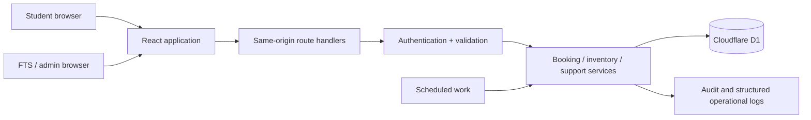
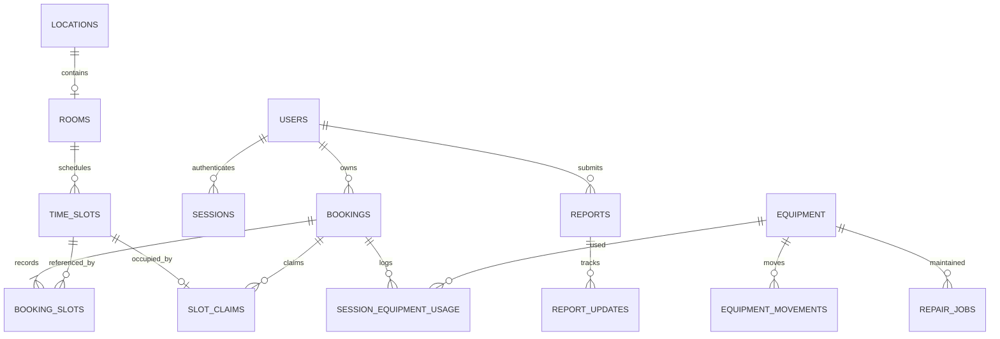

# Practice Ready — Implementation Architecture

**Date:** 2026-10-04 · **Status:** Proposed target, not a description of completed code

**Requirements:** [PRD](PRD.md) · **Baseline:** [Current-state audit](CURRENT_STATE.md)

## 1. Architecture decision

**Keep TypeScript, React, Tailwind, Cloudflare Workers, D1 and Drizzle. Build a modular application in the existing repository.**

The present gaps are incorrect data integration, missing workflows and consistency guarantees. A language rewrite does not resolve them. The existing UI, database entities, Workers deployment shape and shared language are reusable for a single-campus service.

| Layer | Choice | Rationale |
|---|---|---|
| UI | React 19 + existing components/Tailwind | Reuse the prototype's visual language and interaction work. |
| Routing/runtime | Existing Vinext App Router + Vite on Workers | Lowest migration cost; pin versions and verify a clean local/staging build in P0. |
| API | Same-origin TypeScript route handlers | Cookie authentication, shared schemas and one deployment. |
| Persistence | D1 SQLite + Drizzle; prepared SQL where required | Small relational domain; constraints and atomic batches can enforce slot ownership. |
| Input/contracts | Zod schemas shared by server/client | Already installed; replace `any` and compile-time-only request assertions. |
| Server state | Typed fetch/query hooks with explicit invalidation | Retain the small client initially; introduce a query library only if cache complexity warrants it. |
| Authentication | Existing credentials plus revocable database sessions | Reuse credential hashes; remove role/secret/guest weaknesses. Institutional SSO is an integration decision, not a prerequisite for the demo. |
| Tests | Node unit tests + Workers/D1 integration harness + Playwright | Cover domain rules, actual persistence semantics and user journeys. The latter two harnesses must be added. |
| Background work | Cloudflare scheduled handler | Rolling slot generation and overdue/freshness flags; use the same domain services as HTTP handlers. |

Vinext is currently pinned to a beta version. Time-box any framework-blocking deployment problem in P0 to two engineering days. If a required API, cookie or Worker behavior cannot be made repeatable, record an ADR and use stable Next.js on Node with managed PostgreSQL, preserving the React UI and domain contracts. That is a contingency with a new estimate, not a second implementation to build in parallel. Database constraints/transaction SQL would need a deliberate port.

## 2. Runtime boundaries



Use one deployable application, with domain modules rather than microservices. HTTP handlers parse requests, authorize, call a service and map errors. Database invariants belong in the database as well as the service. Browsers cannot decide booking ownership, role, equipment truth or policy validity.

### Proposed organization

```text
app/
  page.tsx                         Home
  rooms/                          Discovery and room detail
  book/                           Availability and booking flow
  equipment/                      Directory and item detail
  reservations/                   Upcoming/active bookings and usage
  support/                        Reports and assistance
  staff/                          Operational workspace
  api/                            Thin route adapters
components/
  booking/ equipment/ rooms/ support/ shared/ ui/
lib/
  contracts/                      Zod inputs, response types and error codes
  domain/                         Time, policy, readiness and search functions
  server/                         Auth, services and D1 repositories
  client/                         Fetch wrappers, query keys and invalidation
  demo/                           Explicit prototype fixtures
db/                               Drizzle schema
drizzle/                          Reviewed migrations
tests/
  unit/ integration/ e2e/
```

These are target directories. Move code incrementally out of `app/page.tsx`; keep current paths working until each vertical slice has migrated.

## 3. Data model

Retain stable room codes and public asset labels; use database IDs for relations. Never derive a primary key from “MPR 3” or an array position. Keep `rooms` and `locations` distinct: many equipment locations are not bookable rooms. Add an explicit `rooms.location_id` relation.

| Entity | Current → target changes / important invariants |
|---|---|
| `users` | Existing accounts; add activation state and timestamps. Administrative role changes are audited. |
| `sessions` | New opaque-token hash, user FK, expiry and revocation. Never store the bearer token in plaintext. |
| `rooms` | Add unique location FK, usable/restricted/closed/unknown condition, booking eligibility, structured restrictions and verification time. Preserve `code UNIQUE`. |
| `locations` | Existing stable code/name/type; distinguish known physical location from unknown location. A location can be staff-only without being a bookable room. |
| `booking_policies`, `room_hours`, `room_closures` | Versioned slot/horizon/duration/cancellation rules, opening windows and exceptional blocks. Referenced policy is immutable after publication. |
| `practice_profiles`, `practice_requirements`, `room_practice_types` | Vocal/band/instrument profile variants, equipment type/quantity requirements and supported activities. |
| `equipment` | Retain asset label, default/current location and default room. Add normalized condition, location state, version, `location_verified_at`, `condition_verified_at`, verifier and limitation notes. Current location may be unknown/null with a last-known location stored separately. |
| `equipment_inspections` | New immutable observation: asset, condition, inspector, observed time and notes. Current equipment fields are a projection. |
| `repair_jobs`, `repair_updates` | Asset FK, stage, nullable expected return, opened/closed time, technician and chronological updates. At most one open repair per asset. |
| `equipment_movements` | Actual moves record source/destination, actor, optional booking, expected/actual return and version. Equipment/location policy controls student movement rights; one open temporary move per asset. |
| `time_slots` | Canonical `start_at`/`end_at` UTC instants, room FK, blocked state and policy context; unique `(room_id, start_at)` and fixed slot duration. “Booked” is derived from a claim. |
| `bookings` | Owner FK required for live records, room, start/end instants, status, policy version, version counter and collision-resistant unique reference. Add cancellation metadata. |
| `booking_slots` | Historical relationship retained; unique `(booking_id, time_slot_id)`. Historical links do not themselves exclude future bookings. |
| `slot_claims` | New **`time_slot_id PRIMARY KEY`**, booking FK: exclusive active room occupancy. Deleting a claim frees occupancy without erasing history. |
| `student_slot_claims` | New unique `(user_id, start_at)` plus booking FK: prevents the same student booking overlapping rooms. Released with room claims. |
| `session_equipment_usage` | Booking FK, equipment FK, actor and logged time; unique `(booking_id, equipment_id)` for the V1 first-submission flow. Preserve a snapshot of relevant asset labels/location. |
| `reports`, `report_updates` | Reporter, category (equipment/room/assistance), context FKs, description, status, assigned technician and resolution. Staff notes have separate visibility from student-facing updates. |
| `audit_events` | Actor, action, entity, previous/new values or change details, reason, time and request ID. Append-only through application roles. |
| `idempotency_records` | Unique `(actor_id, operation, key)`, request hash, result identifier, response snapshot/status and expiry. Committed alongside the mutation. |

Use foreign keys and actual SQL `CHECK`/unique constraints for allowed states; Drizzle TypeScript enum hints alone do not validate arbitrary HTTP JSON or constrain existing SQLite columns.

### Independent equipment facts

```text
condition:       functional | partial | damaged | out_of_service | unknown
location_state:  known | missing | unknown
maintenance:     derived from open repair job
movement:        derived from open executed movement
room_readiness:  derived from location + condition + freshness + requirements
```

“Away” is relative to a room/default location. It is not a condition. Keep familiar ready/away/needs-attention UI badges as computed summaries, with details that expose the independent facts. Do not turn an overdue return or estimated repair completion into an automatic physical return/repair.

### Relationships



## 4. Time and availability contract

- Policy calculations use `Asia/Kolkata` initially, with an explicit IANA timezone per campus configuration.
- Store UTC epoch milliseconds or an equivalently consistent UTC timestamp representation. Pick one representation for all scheduling tables in the migration.
- Availability accepts a campus date and returns structured slots: `{ id, startAt, endAt, state, period, label }`. Display labels never become request times.
- A booking request sends returned `slotIds`; server reloads them and validates room, continuity, duration, future start, horizon and policy. Client-supplied derived duration/condition is not authoritative.
- Midnight is the next-day instant. Do not use `toISOString().split("T")[0]` to derive the selected campus calendar date.
- Generate the configured rolling horizon idempotently using unique slot keys and conflict-safe insertion. Availability reads should not create arbitrary dates. A gap in generated coverage is an operational error/explicit unavailable state, not an empty day falsely presented as fully free.
- While booking/equipment screens are visible, refresh relevant availability/readiness on a 30-second interval and on focus. Immediately invalidate affected queries after a mutation. Final writes always revalidate.

## 5. Booking consistency on D1

Cloudflare documents [`D1Database.batch()`](https://developers.cloudflare.com/d1/worker-api/d1-database/#batch) as transactional: a failed statement rolls back the batch. Use that supported API (or a verified equivalent Drizzle batch), rather than assuming an interactive `BEGIN`/`COMMIT` transaction callback works on D1.

**A preflight read is advisory. The database write must enforce every exclusion.**

### Create

1. Authenticate the active user, validate the request schema and look up any completed idempotency result.
2. Read selected slot metadata to provide useful validation messages; generate a collision-resistant booking reference/operation identifier before the batch.
3. In one batch, insert the booking, history links, room claims, student claims, audit entry and idempotency result. Use the pre-generated identifier or stable reference to relate statements without an intermediate network round trip.
4. Unique room/student claim constraints reject competing requests. SQL guards/triggers enforce exact expected slot count, open room/slots, current policy and the required booking state within this same transaction.
5. Return `201` only after the batch commits. Translate known claim/guard failures to a structured `409` or validation error and reload affected slots. Unexpected failures return an opaque request ID and server-side diagnostics.

An `UPDATE ... WHERE ...` or `INSERT ... SELECT ...` that affects zero rows does **not** fail a batch automatically. Guard failures must raise an actual constraint/trigger error; checking row counts after other statements commit is too late. Include failure-injection tests for each step and concurrent room closure/policy change. Preserve D1 parameter limits when constructing statements; do not split one logical booking across independent batches.

### Cancellation and rescheduling

- Cancellation checks ownership, state, expected version and cutoff inside the atomic operation; deletes only claims for that booking, marks it cancelled and writes an audit event. Repetition returns the cancelled result without freeing another booking's claims.
- Rescheduling computes retained, added and removed slots. In one batch, conditionally advance the booking version, release removed claims, acquire added claims, update history and booking metadata, and audit the change. Retained claims stay owned. Any error rolls back the release as well as the acquisition, preserving the original booking.
- All mutations against one booking require a version/state guard that **fails the transaction** on mismatch. This prevents simultaneous cancel/reschedule requests from acting on stale state.
- A room closure uses the same database-enforced block rules. Show affected reservations to staff and resolve them through recorded cancellation/rescheduling before publishing the block, or use a bounded atomic administrative closure operation. Never merely mark a room closed while silently retaining conflicting usable bookings.
- Idempotent replay with identical actor/operation/key/body returns the original result. Reusing the key with another body returns `409 IDEMPOTENCY_MISMATCH`. Following a lost response, the client retries the same key and stays “checking confirmation” until the outcome is known.

### Verification required before pilot

On a real local Worker/D1 instance, race at least 20 booking requests for one slot: exactly one creates occupancy, the others conflict, and no losing booking/history/idempotency rows remain. Repeat with overlapping multi-slot requests, adjacent valid requests, identical idempotency keys, cancelled/rebooked slots, and overlapping bookings for one student across rooms. Repeat the critical scenarios on staging D1.

## 6. Authentication and permissions

- Registration creates `student` only; account eligibility is based on the confirmed institutional policy. First administrator is provisioned through one-time operator tooling, not a public seed route.
- Reuse password hashes during migration; choose and benchmark the password-hash policy in the actual Worker runtime. Never trim passwords before hashing or verification.
- Issue opaque high-entropy session tokens; store token hashes server-side, rotate at login, and revoke at logout/password reset/deactivation. Read current account role/state for privileged mutations.
- Cookies: `HttpOnly`, `SameSite=Lax`, `Path=/`, `Secure` over production HTTPS, explicit expiry. Validate allowed origin on cookie-authenticated writes and apply login/register throttling.
- Move initial catalog/demo seed to explicit local/operator tooling. Demo accounts and guest mutations belong to isolated demo persistence.
- Implement `requireUser`, `requireRole` and resource-ownership helpers once and cover them with route tests. Unauthorized requests return `401`; authenticated insufficient authority returns `403` (or `404` for private resource existence).
- Recovery for the pilot can be an audited administrator-issued expiring reset link; automated email and SSO can follow the institution's actual identity setup.

## 7. Readiness, relocation and support services

### Suitability evaluation

Input: practice profile/variant, instrument requirements, party size, date and slot range. First filter hard constraints: opening hours, closure, activity restriction, capacity and slot availability. Then compare required types/quantities with verified assets physically in the room and acceptable condition. Account for setup dependencies such as a keyboard's power adapter or a usable drum kit's required components.

Return `match | partial | unavailable | unverified` with machine-readable reasons and plain-language explanations. Current equipment observations and future-room availability are separate fields. An expected return before a future booking may be shown as an estimate, never counted as confirmed future readiness.

Extract the existing alias/prefix/type-first search functions into a shared domain module. Define regression examples (`mic cable`, `guitar`, asset ID, `tom` versus `Custom`) before replacing fixtures. A small campus catalog does not require an external search service.

### Relocation / repair state transitions

```text
Physical move:      open → returned (or corrected by staff with audit)
Repair:            reported → assessing → awaiting_parts | in_repair
                   → awaiting_inspection → completed
Report:            open → acknowledged → in_progress → resolved → closed
                   resolved/closed → reopened (with explanation)
```

Logging an actual move updates movement record, equipment location/version and audit in one batch with a stale-version guard. FTS can log campus moves; student logging requires an active session, a policy-designated movable asset present in that room and a permitted destination. The originating student may record the move's return after the session, and FTS can correct any movement with an audit reason. An explicit inspection updates condition verification. Reports and repairs can be linked without treating a student report as a verified diagnosis.

## 8. Proposed API surface

This is the **target** contract. The [README](../README.md) lists routes that exist today. Preserve existing route names where practical, but migrate the first-party client and server together to typed structured-slot payloads.

| Group | Proposed routes | Access / key behavior |
|---|---|---|
| Account | Existing `/api/auth/register`, `/login`, `/logout`, `/me`; reset/activation endpoints | Self-service student registration subject to eligibility; managed sessions |
| Rooms | `GET /api/rooms`, `GET /api/rooms/:id`, `GET /api/rooms/search` | Signed-in discovery, details and explained suitability |
| Slots | `GET /api/availability?roomId=&date=` | Campus date, structured slot IDs/instants, policy and freshness metadata |
| Bookings | `POST /api/bookings`, `GET /api/bookings?filter=upcoming\|active`, `GET /api/bookings/:id` | Owned data; POST requires `Idempotency-Key` and `{roomId, slotIds, policyVersionId}` |
| Manage | `PATCH /api/bookings/:id/reschedule`, `DELETE /api/bookings/:id` | Owner before cutoff or authorized staff; version-aware, atomic and idempotent |
| Session use | `POST /api/bookings/:id/equipment-usage`, `GET /api/bookings/:id/equipment-usage` | Owner in active session; staff operational read; immutable student first submission |
| Catalog | `GET /api/equipment`, `GET /api/equipment/:id`, existing room-equipment route; `GET /api/locations` | Typed search/filter results and normalized independent facts |
| Repairs | `GET /api/equipment/:id/repairs` | Student-safe stage/ETA details; private technician notes excluded |
| Relocation | `POST /api/equipment/:id/movements`, `POST /api/movements/:id/return`, `GET /api/movements?mine=true` | Actual moves/returns; authorized FTS or policy-scoped student; atomic location update |
| Reports | `POST /api/reports`, `GET /api/reports?mine=true`, `GET /api/reports/:id` | Own reports and assistance requests with context and status |
| Rules/help | `GET /api/policies/current`, `GET /api/support/contact` | Published rules and verified contact information |
| Staff catalog | `/api/staff/rooms`, `/locations`, `/equipment`, `/practice-profiles`, `/policies` | CRUD with role checks; archive referenced entities instead of deleting history |
| Staff operations | `/api/staff/inspections`, `/repairs`, `/movements`, `/reports`, `/closures`, `/bookings` | Explicit state transitions, audit and version guards |
| Administration | `/api/admin/users/:id/role`, `/status`, `/reset-link` | Admin-only account lifecycle and revocation |

List endpoints use bounded pagination and documented filters. Student availability responses expose occupancy only; staff listings expose only operationally necessary identity fields.

### Error and conflict example

```json
{
  "error": {
    "code": "BOOKING_CONFLICT",
    "message": "One or more selected slots are no longer available.",
    "details": { "conflictingSlotIds": [421, 422] },
    "requestId": "request_01"
  }
}
```

Use `400` invalid shape, `401` sign-in required, `403` forbidden, `404` missing, `409` conflict/stale state, `422` policy rejection, `429` throttled and `500` unexpected failure. The current string-shaped errors need an adapter while migrating; do not label this target envelope as already implemented.

## 9. Migration and deployment

1. Capture an inventory of existing data and an export/restore point. Distinguish disposable demo data from any actual reservations before backfill.
2. Establish one migration runner using reviewed `drizzle/` SQL and a consistent migration ledger. Configure Wrangler's `migrations_dir` explicitly; reconcile any database initialized by direct SQL before introducing tracking.
3. Audit duplicate slots, conflicting active bookings, guest records and invalid dates. Produce a conflict report; do not silently discard one booking to make a unique index succeed.
4. Add new tables/nullable columns. Link rooms to locations by explicit stable codes; validate all mappings. Backfill timestamps using the confirmed campus timezone and handle midnight explicitly.
5. Reconcile claims for confirmed future/active bookings, then add/validate uniqueness and state constraints. Archive historical links separately from active occupancy.
6. Introduce typed APIs and UI slices. Keep demo fixtures behind an explicit mode with separate storage. Deactivate old mutation contracts after the client rollout.
7. Apply migrations to local → staging → production; review plans and backups before the production step. Deploy built Worker assets using the generated Wrangler config with the intended environment bindings.
8. On failure, use the previous compatible application build; prefer additive schema changes so rollback remains possible. Restore a backup only with a plan for writes made since that backup.

Keep independent databases and secrets for development/staging/production. Store secrets in Worker bindings, with `.env.local` used only for ignored local configuration. GitHub Pages serves the research case study; it cannot host the Worker API/D1 system.

## 10. Operability and delivery checks

- Structured request IDs, error rates, booking conflicts, failed mutations and query latency; exclude credentials and sensitive free text from logs.
- Staff views for overdue movements, stale inspections, outstanding reports and repairs without estimates.
- Daily invariant checks: no orphan active claims, no confirmed booking missing claims, no duplicate active movement and no closed room with unresolved active occupancy.
- Verify backup/restore to an isolated database before pilot; choose retention with the institution.
- CI target: frozen install, lint, `tsc --noEmit`, domain tests, real Worker/D1 tests, build and browser smoke tests. A successful Vite build alone is not typechecking or concurrency evidence.
- Check compressed Worker deployment size and runtime CPU/memory on the actual Cloudflare plan; split the large page and avoid bundling unnecessary assets/code before pilot.

The full acceptance matrix and test scenarios are in the [implementation plan](IMPLEMENTATION_PLAN.md).
