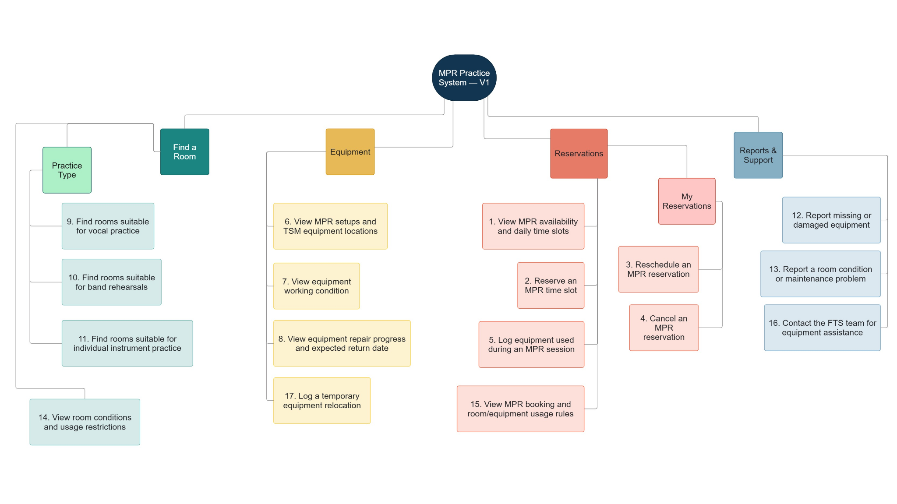

# Practice Ready — Product Requirements Document

**Version:** 1.0 · **Date:** 2026-10-04 · **Status:** Proposed implementation baseline

**Product:** Music Practice Room (MPR) readiness and reservations for True School of Music (TSM)

**Delivery target:** All 17 capabilities in the supplied V1 information-architecture diagram

## 1. Product objective

Help a student answer, before leaving for practice:

> Which available room supports my practice, is the equipment actually there and working, and can I reserve it reliably?

Practice Ready combines room discovery, dependable reservations, equipment whereabouts, working condition, repair information, and technical support. Success requires both a student-facing application and a small staff workspace that keeps the information trustworthy.

### Research basis

The [published case study](https://asmib170.github.io/practice-ready/) reports three interviews, ten card-sort participants, and seven tree-test participants across two rounds. Elizabeth's missing-mixer scenario involved approximately 10–15 minutes of searching before practising without amplification. This is a reported scenario, not a measured average across the student population.

The research identifies uncertainty about equipment and suitability as the central problem. A free room alone does not solve it. The original [interactive prototype](https://practice-ready.asmi-battoo.workers.dev) provides a strong visual and interaction starting point; its inventory is illustrative.

## 2. Scope and release boundaries

| Release | Commitment |
|---|---|
| **Pilot / MVP** | Research Must-Haves **F01, F02, F06, F07**: availability, booking, equipment locations, and working condition. Includes the technical foundations required to operate them: authentication, conflict-safe persistence, staff data corrections, and honest error states. |
| **Full V1** | All **F01–F17** in the user's supplied image, with working student and staff journeys. The pilot is an intermediate milestone, not completion of the request. |
| **V1.1 candidates** | **F18** student editing of equipment-use/relocation records and **F19** completed-reservation/session history, introduced in the published V2 research. Historical storage and staff audit access are needed in V1; the complete student history/editor experience is later. |

The website's final research IA has **19** features and five navigation branches; the supplied image has **17** features and four branches. Retain the requested 17-feature delivery scope while adopting the clearer **Book a Room / My Reservations** navigation split. This uses the research without silently expanding the launch scope.



### Outside V1

Payments, public equipment rental, exclusive equipment reservations, automatic borrowing rights, native mobile apps, multi-campus tenancy, timetable/ERP integration, AI recommendations, live chat, and an analytics warehouse. Email/SMS/push alerts and report photo uploads are follow-up enhancements; in-app records and support contact details are sufficient for V1.

## 3. Users and responsibilities

| Actor | Needs | V1 authority |
|---|---|---|
| Student | Find a suitable room, reserve it, manage own booking, see equipment truth, report an issue | Own reservations and session logs; own reports/support requests; log policy-permitted equipment movements during an active session |
| FTS technician | Know what needs attention and where assets are | Update verified condition/location, execute relocations and returns, manage repairs, triage reports, assist students |
| Facilities administrator | Manage access, schedules, closures, inventory, policies | Technician capabilities plus role assignment, room/catalog administration, policy publishing and administrative booking changes |
| Visitor | Understand the service | Landing page, public rules/support information and clearly labelled demo; operational data requires sign-in by default |

FTS is the technical-support team named in the research; confirm its formal name and contact information with TSM. Technician access to booking information is limited to operational fields. Students never see another student's identity in availability results.

### Operational ownership

- FTS verifies equipment during opening checks and records a movement when it occurs.
- Facilities maintains room restrictions, opening hours, and published booking rules.
- Reports remain student observations until reviewed; submitting a report does not silently overwrite verified inventory.
- The equipment owner sets repair estimates. Unknown dates stay unknown; an overdue estimate is labelled overdue rather than automatically marking an item ready.

## 4. Navigation and principal screens

```text
Home
├── Find a Room
│   ├── Practice Type: Vocal / Band / Individual Instrument
│   └── Room Detail: suitability, conditions, restrictions, setup
├── Equipment
│   ├── Directory / Search / Browse by Location
│   ├── Item Detail: default/current location, condition, repair progress
│   └── Temporary Relocation / Return
├── Book a Room
│   ├── Availability & Daily Slots
│   ├── Equipment Review → Booking Review → Confirmation
│   └── Booking and Usage Rules
├── My Reservations
│   ├── Upcoming: details, reschedule, cancel
│   └── Active: equipment-use log
└── Reports & Support
    ├── Missing or Damaged Equipment
    ├── Room Condition / Maintenance
    └── Contact FTS / My Requests

Staff workspace: inventory, inspections, repairs, relocations,
reports, room closures, policies, and operational reservations
```

Equipment-use logging has one canonical home in an active reservation, with a contextual link from booking/session screens. This preserves F05's reservation context without duplicating records. Every top-level destination has a real URL, browser-back support, and a mobile layout.

## 5. Feature requirements and acceptance criteria

Feature numbers below match the diagram exactly. **Pilot** means one of the four research Must-Haves. Every other row remains mandatory for **Full V1**.

| ID / release | Requirement | Testable acceptance criteria |
|---|---|---|
| **F01 · Pilot** | View MPR availability and daily time slots | Selecting a date and room returns server-backed 30-minute slots with available, booked, closed/maintenance and past states. Browser refresh preserves the selected date/room. No other student's identity is exposed. A network failure shows an error, never fabricated availability. |
| **F02 · Pilot** | Reserve an MPR time slot | A signed-in student selects 1–6 consecutive slots and receives a persisted booking reference, room, date and time. Concurrent overlapping requests yield at most one winner per slot; losers receive `409` with recovery choices. Retrying the same request does not create another booking. Confirmation appears only after a committed server result. |
| **F03 · V1** | Reschedule an MPR reservation | Owner selects a new room/time for an upcoming reservation. All booking rules are rechecked. If the target is taken, the original reservation remains intact. A successful change updates the same booking and records the previous values in its audit trail. |
| **F04 · V1** | Cancel an MPR reservation | Owner can cancel before start time under the published policy. Confirmation releases only that booking's claims. Repeating cancellation is harmless, and another user can reserve the released interval. Technician/admin overrides require a recorded reason. |
| **F05 · V1** | Log equipment used during an MPR session | During an active reservation, the owner selects asset IDs from the room's present, usable default setup; a verified incoming relocation can also appear. Submission persists actor, session, assets and observation time, with a receipt. Duplicate submission cannot duplicate usage. First submission is supported in V1; student editing of existing records is F18. |
| **F06 · Pilot** | View MPR setups and TSM equipment locations | Room view distinguishes default assignment from items currently present. Directory searches name, asset ID, type and established aliases, and displays default/current locations and last verification time. An unknown location is explicit. An item found elsewhere is not described as available to borrow. |
| **F07 · Pilot** | View equipment working condition | Every asset displays a written functional/partial/damaged/out-of-service/unknown condition and relevant limitation. Location and condition remain independent: moved equipment can also be damaged. An FTS correction is visible after refresh and attributed in the staff audit trail. |
| **F08 · V1** | View repair progress and expected return date | Item detail shows repair stage, most recent update and a nullable expected-return date. Unknown and overdue estimates are explicit. Closing a repair requires a recorded inspection before the item becomes ready. |
| **F09 · V1** | Find rooms suitable for vocal practice | Student selects vocal practice, date/time, party size and amplified/acoustic needs. Results explain which required equipment is present and usable and why a room is excluded or only partially suitable. A room with an absent required mixer cannot be a full amplified-vocal match. |
| **F10 · V1** | Find rooms suitable for band rehearsals | Results consider party size, configured rehearsal/noise restrictions and selected setup needs. A room below capacity or missing a required drum component is not a full match. Selecting a result carries the criteria into booking review. |
| **F11 · V1** | Find rooms suitable for individual instrument practice | Student selects the instrument and whether they bring their own. Results use required instrument/accessory/setup needs and room restrictions. Unknown setup data is labelled unverified rather than suitable. |
| **F12 · V1** | Report missing or damaged equipment | Student submits equipment ID when known, location, issue type and description; unknown-asset reports are possible. A persisted report reference and status are returned. FTS can acknowledge, investigate and resolve it; resolution records an outcome and can link a repair. |
| **F13 · V1** | Report a room condition or maintenance problem | Student selects a room and concern and receives a report reference. FTS can triage and link a room restriction/closure. Submitting a report alone does not remove other students' bookings; staff action records how affected reservations were handled. |
| **F14 · V1** | View room conditions and usage restrictions | Room detail shows usable/restricted/closed/unknown state, capacity, applicable limitations and update time. Closure blocks new bookings in the server as well as the UI. Restricted rooms explain which activities are allowed. |
| **F15 · V1** | View booking and room/equipment usage rules | Rules are accessible before confirmation and include slot duration, advance window, opening hours, cancellation expectations and equipment handling. Server enforcement uses the same versioned policy. Booking stores the accepted policy version. |
| **F16 · V1** | Contact FTS for equipment assistance | Student sees verified support hours/contact channels and can submit a contextual assistance request, optionally linked to a room, asset or booking. Submission returns a reference visible in My Requests; FTS sees it in its queue. Displayed email/phone actions do not claim that a message was sent by this app. |
| **F17 · V1** | Log a temporary equipment relocation | Authorized user records asset, actual source/destination, reason, actor and expected return. FTS can log campus movements; a student can log a policy-permitted move from their active session's room. Recording an actual move updates current location and movement record atomically. Only one open move per asset is allowed. Return closes the move and records the actual destination/time; overdue moves remain open. |

### Supporting requirements

These enable the numbered features and do not replace any of them:

- Sign-in/out, account activation/deactivation, administrator-controlled role changes, and a practical account-recovery path.
- Staff catalog management: rooms, locations, assets, practice profiles and equipment requirements.
- Distinguishable loading, empty, stale, error, conflict, unauthorized and success states on every data-driven screen.
- Audit records for booking changes, asset movement/condition changes, role changes, closures and report resolutions.
- Explicit demo mode isolated from live operations, including the existing Booking Conflict Demo.

## 6. Core journeys

### A. Elizabeth prepares for amplified vocals

1. Sign in → Find a Room → Vocal → date/time → amplified setup.
2. Inspect results: room availability plus microphone, mixer, speaker, cables and stand readiness.
3. Open a room, see a moved mixer and its current location; inspect another suitable room or contact FTS.
4. Select consecutive slots, read applicable rules, review and confirm.
5. Receive the server booking reference; find it again under My Reservations after a reload.

### B. Two students choose the same slot

1. Both initially see the slot as available; viewing it does not hold it.
2. One booking commits. The other receives a conflict and refreshed availability.
3. The losing student retains their date and practice criteria and selects another time/room.
4. No losing booking, partial claim, or false-success screen remains.

### C. Plans change

1. Owner opens an upcoming booking and chooses reschedule.
2. Target availability is checked at write time; failure leaves the old booking usable.
3. Alternatively, cancellation releases the booking and shows its cancelled status immediately.

### D. Equipment requires attention

1. Student reports a damaged microphone from its item or session screen.
2. FTS triages the report, verifies condition and opens a repair record.
3. Students see that it is unusable, its repair stage and the estimate or “not yet known.”
4. FTS records completed repair and inspection, resolves the linked report and restores readiness.

### E. A mixer moves temporarily

1. FTS records the move from MPR 3 to Arts Block A, with expected return.
2. MPR 3 immediately loses that asset from its present/ready setup; the directory shows its actual location.
3. Return records actual destination and inspection status; availability is not inferred from the expected-return time.

## 7. Business rules and proposed defaults

The following defaults are implementable starting decisions, **not claims about approved TSM policy**. Confirm them in P0 of the [implementation plan](IMPLEMENTATION_PLAN.md).

| Topic | Proposed V1 rule |
|---|---|
| Campus clock | `Asia/Kolkata`; store absolute start/end instants in UTC, display campus time with a timezone label. |
| Slot size / duration | 30 minutes; minimum 30 and maximum 180 minutes; consecutive only. |
| Booking horizon | Today through the next 13 campus dates (14 dates including today); starts must be in the future. |
| Opening hours | Initially 06:00–24:00 campus time, configurable per room/day. The prototype's 06:00–next-day-06:00 schedule conflicts with the backend; resolve before pilot. |
| Midnight | End of a 23:30 slot is next-day 00:00. Store the next-day instant, never an ambiguous same-date `00:00`. |
| Ownership | Live bookings require an active account. Guests use isolated demo data. |
| Student overlap | A student cannot hold overlapping confirmed bookings in different rooms. No recurring/group co-ownership in V1. |
| Booking lifecycle | Persist confirmed/cancelled; derive upcoming/active/ended from time. Completed can be materialized for later history. Student cancellation/reschedule is before start; staff overrides record reasons. |
| Equipment guarantees | A room booking reserves room time only. Show equipment observed now and recheck before confirmation; do not promise that future equipment readiness is guaranteed. |
| Freshness | Display actual observation time. Proposed stale threshold: one operating day; unknown/stale required setup cannot be a verified full match. A relocation is not an inspection. |
| Partial suitability | Explain missing/partial requirements. User may change requirements or knowingly book an otherwise usable room; closure/capacity/activity restrictions remain hard blocks. |
| Rules changes | Apply current policy to new/rescheduled reservations; existing bookings keep their accepted version unless a recorded administrative intervention is required. |
| Relocation permission | FTS can log moves/returns; students can log only policy-designated movable equipment from their active session's room to permitted locations. The student who logged a move can record its return even after the session ends. Booking a room alone does not make all equipment movable; confirm designated assets with FTS. |

Practice profiles are editable, deterministic requirement sets. “Vocal” must distinguish acoustic practice from amplified performance preparation. “Band” needs user-selected instrumentation and party size; hardcoded room-name recommendations are insufficient.

## 8. Quality requirements

Targets below are proposed acceptance targets for the campus pilot, not current measurements.

| Area | Acceptance target |
|---|---|
| Correctness | Zero double-booked room slots and zero false-success confirmations in automated concurrency/failure scenarios. |
| Data freshness | A committed staff correction appears to another client on refresh and within 30 seconds while the relevant screen is open. Show observation age separately from fetch time. |
| Responsiveness | p95 API reads under 500 ms and booking writes under 1 second in staging at 50 concurrent users; measure and record dataset, region and Worker plan. |
| Accessibility | WCAG 2.2 AA for core flows: keyboard completion, focus handling, labelled controls, text status, contrast, reduced motion and accessible errors. Booking works with all audio off. |
| Mobile | Core journeys work at 360 CSS px and above, including date/slot selection, report submission and staff quick updates. |
| Reliability | Target 99.5% monthly availability during pilot; one documented restore exercise before operational rollout. No offline mutation queue in V1. |
| Account/data access | Server-enforced ownership and roles; authenticated data is not publicly cached. Operational views minimize personal information. |

Audio and animation are enhancements. Keep the established visual identity where it supports usability, but allow layout/navigation changes needed for new features. Provide persistent, accessible audio controls; sound cannot be the only success/error feedback.

## 9. Pilot measurement

| Outcome | Proposed target | Measurement |
|---|---|---|
| Find a suitable available room | At least 90% unassisted completion in a 10–15-student pilot | Moderated tasks across vocal, band and individual users; record failures and time |
| Time to a confident room choice | Median under 2 minutes | From discovery start to reviewed suitable room; compare with a fresh pre-pilot baseline |
| Booking reliability | No confirmed double bookings; no false confirmations | Daily invariant checks plus failure/concurrency tests |
| Inventory truth | At least 95% agreement for pilot assets | FTS spot-check sample of actual location/condition against records |
| Issue response | At least 90% acknowledged within one staffed working day | Report timestamps compared with published support hours |

Collect minimal events such as search, room review, booking result/conflict, report creation and staff update. Never put passwords, session tokens, or report free text into analytics. Small research samples and the published 35/35 tree-test results demonstrate navigation evidence, not production reliability.

## 10. Decisions to confirm

| Decision | Proposed owner | Needed by |
|---|---|---|
| Operating hours, timezone, holidays, advance window and cancellation cutoff | Facilities + product owner | P0, before slot implementation |
| Actual room list, MPR 1 condition, Performance Hall bookability, capacities and asset inventory | FTS + facilities | Before P2 pilot data import |
| Institutional email/roster eligibility and recovery contact; SSO availability | TSM IT + product owner | P1 |
| Who can move assets and which areas students may access | FTS + facilities | P4 |
| Vocal/band/instrument setup requirements and acceptable partial conditions | Faculty + FTS | P4 |
| Inspection cadence, repair updates, support hours and queue owner | FTS lead | Before pilot / P5 support launch |
| Retention for accounts, booking history, reports and audit records | Product owner + TSM operations | Before operational data collection |
| Whether F18/F19 must be pulled into launch | Product owner | Before P3; otherwise V1.1 |

## 11. Definition of Full V1 complete

- Every F01–F17 acceptance row is demonstrated on a shared staging deployment with persisted data.
- Student and staff end-to-end flows pass, including authorization failures and concurrent requests.
- A second browser sees bookings, condition changes and movements; reloads do not revert to fixtures.
- Failed booking/reschedule/relocation operations preserve the previous valid state.
- FTS has verified the initial pilot inventory and can maintain it through the staff UI.
- The pilot targets, actual results, remaining defects and launch decision are recorded.
- Setup, migrations, deployment, restore and operational responsibilities are documented and rehearsed.

## Related documents

- [Current-state audit](CURRENT_STATE.md) — what exists and what is incomplete.
- [Architecture](ARCHITECTURE.md) — proposed data model, consistency rules and API contracts.
- [Implementation plan](IMPLEMENTATION_PLAN.md) — ordered work packages and release gates.
